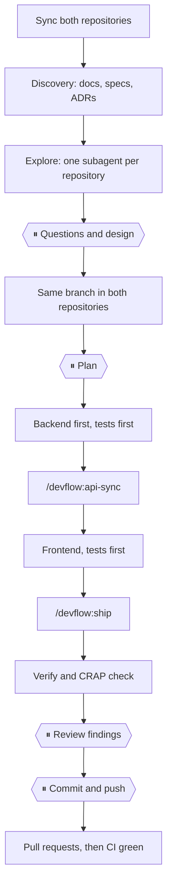

<div align="center">

# devflow

**One workflow for every change that crosses a backend and a frontend repository.**


</div>

## 🧭 What is devflow

devflow is a [Claude Code](https://claude.com/claude-code) plugin with five slash commands. They
carry a change through two repositories, a backend and a frontend, the same way every time: sync,
plan, tests first, verify, review, ship.

The commands call the installed `superpowers` skills for the generic parts (brainstorming, plans,
TDD, debugging, verification) and add what is specific to two repositories: reading both, creating
the same branch in both, and merging in the right order.

## 💡 Why

A change that spans two repositories goes wrong in the same few ways: one side is out of date, the
branches have different names, the frontend ships before the backend, a step is skipped when you are
in a hurry. devflow writes the order down once, makes the scripts do what must be exact, and stops at
the points where a human should decide.

## 🧰 The commands

| Command | What it does |
|---|---|
| [`/devflow:feature`](plugins/devflow/README.md#devflowfeature) | New behaviour, from idea to pull requests |
| [`/devflow:bugfix`](plugins/devflow/README.md#devflowbugfix) | Fix existing behaviour at its root cause, with a proven regression test |
| [`/devflow:api-sync`](plugins/devflow/README.md#devflowapi-sync) | Make the frontend agree with the backend contract |
| [`/devflow:ship`](plugins/devflow/README.md#devflowship) | Verify, review and open the pull request |
| [`/devflow:help`](plugins/devflow/README.md#devflowhelp) | List the commands or explain one |

The full per-command reference, with every step, is in [`plugins/devflow/README.md`](plugins/devflow/README.md).

## 🚀 Quick start

**1. Enable the plugin** in each repository's `.claude/settings.json`:

```json
{
  "extraKnownMarketplaces": {
    "devflow": { "source": { "source": "github", "repo": "caiolucio360/devflow-ai", "ref": "main" } }
  },
  "enabledPlugins": { "devflow@devflow": true },
  "permissions": { "additionalDirectories": ["<path to the other repository>"] }
}
```

To try it once without editing settings: `/plugin install devflow --marketplace caiolucio360/devflow-ai`.

**2. Describe the project** in each repository's `.claude/devflow.json`. `role`, `baseBranch` and
`verify` are required; the rest is optional, and `sibling` is omitted for a single-repository project.

```json
{
  "role": "frontend",
  "sibling": { "role": "backend", "path": "../my-backend" },
  "baseBranch": "dev",
  "verify": ["npm run lint", "npm run test", "npm run build"],
  "crap": "npm run crap",
  "contract": { "generate": "npm run api:generate", "check": "npx tsc --noEmit" },
  "docs": { "repo": ".", "specs": "docs/specs", "plans": "docs/plans", "index": "docs/index.md" }
}
```

The values above are an example. The meaning of each key is in the
[plugin README](plugins/devflow/README.md#installation).

**3. Run a command** from the root of a repository:

```text
/devflow:help
```

## 🔀 The feature flow

`/devflow:feature` is the longest command. The ⏸ nodes are approval points: the command stops and
asks, and goes on only after you say so.



## 🔎 Which command

| Situation | Command |
|---|---|
| New behaviour, a feature, a change in both repositories | `/devflow:feature` |
| Something that worked is wrong | `/devflow:bugfix` |
| The backend changed a DTO or an endpoint | `/devflow:api-sync` |
| Work is done and must become a PR | `/devflow:ship` |
| A small change you can make directly | Make it, then `/devflow:ship` |
| Not sure | `/devflow:help` |

## 📏 Rules the commands enforce

- **CRAP below 15** for every method. A fix is a test or lower complexity, never an exclusion.
- **Parallel Change** across repositories: the backend adds the new shape and merges first, the
  frontend migrates, a later backend PR removes the old shape.
- **Branch prefixes** `feature fix refactor chore docs test release hotfix`, kebab-case, the same
  name in both repositories. A branch is created from a fresh `origin/<baseBranch>` with no upstream.
- **Verification before a PR:** every `verify` command run and its output read; CI green before a PR
  counts as ready.
- **No attribution trailers** in commits or PRs.

## ⚙️ How it works

- **Scripts do what must be exact.** Fetching, measuring how far a branch is behind and creating a
  branch live in `plugins/devflow/scripts/`, with tests in `test/`, not in prose.
- **Skills hold the judgement.** Each command is a skill that names its phases and its approval
  points, and shares its rules through `plugins/devflow/shared/conventions.md`.
- **Config is the only place project facts live.** Branch names, commands and paths come from
  `.claude/devflow.json`, so the same plugin serves any pair of repositories.

## ❓ FAQ

<details>
<summary>Does it work without a sibling repository?</summary>

Yes. Omit `sibling` from `.claude/devflow.json` and the commands work on the one repository.
</details>

<details>
<summary>Does it need superpowers?</summary>

The commands call the installed `superpowers` skills for the generic parts (brainstorming, plans,
TDD, debugging, verification), so install that plugin too. `/devflow:help` does not need it.
</details>

<details>
<summary>What does ⏸ mean?</summary>

An approval point. The step ends with a question and nothing after it happens until you approve.
Nothing is pushed, no PR is opened and no plan is executed before its gate.
</details>

<details>
<summary>Where do the commands read project facts from?</summary>

From `.claude/devflow.json` in the working directory, so start a command from the root of a
repository.
</details>

## 🤝 Contributing / adding a command

1. Create `plugins/devflow/skills/<name>/SKILL.md`.
2. Add a `## /devflow:<name>` section to the [plugin README](plugins/devflow/README.md#adding-a-command);
   `scripts/check-readme.sh` fails CI without it.
3. Put logic that must be exact in `plugins/devflow/scripts/` with a test in `test/`.

The steps in full are under "Adding a command" in the plugin README. Run the checks before a pull
request:

```bash
node --test "test/*.test.mjs"
node scripts/check-manifests.mjs
bash scripts/check-readme.sh
```

## 🗂 Project layout

```text
.claude-plugin/marketplace.json      the marketplace (named devflow)
.github/workflows/ci.yml             tests and checks on every pull request
plugins/devflow/
  .claude-plugin/plugin.json         the plugin manifest
  README.md                          the per-command reference; /devflow:help reads it
  shared/conventions.md              the rules every command injects
  scripts/                           sync.mjs, branch.mjs and lib/
  skills/<name>/SKILL.md             one per command: feature, bugfix, api-sync, ship, help
scripts/                             check-manifests.mjs, check-readme.sh
test/                                tests for the scripts above
```
